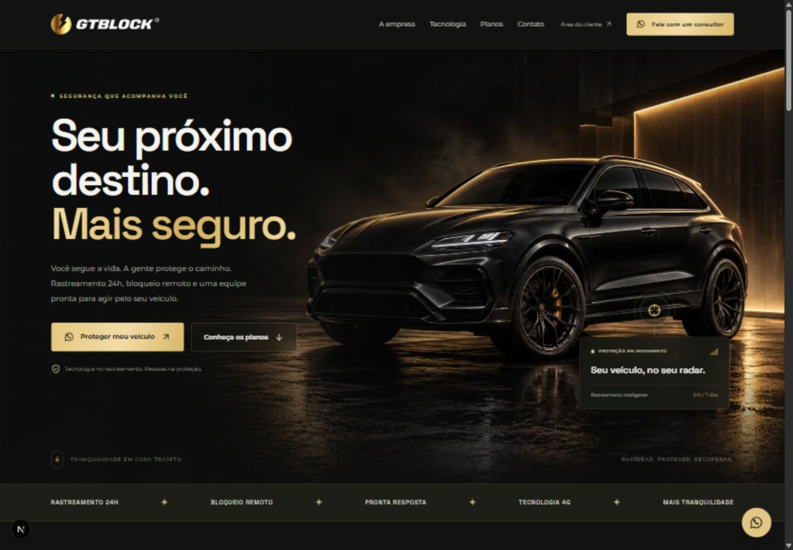
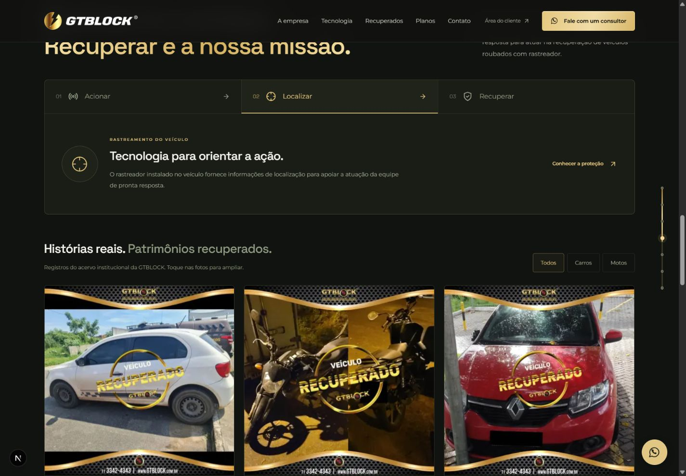

# GTBLOCK

Landing page da GTBLOCK para apresentar rastreamento veicular, pronta resposta e planos de proteção, com contratação pelo WhatsApp.

Next.js App Router · React · TypeScript · Tailwind CSS 4 · Framer Motion · Lucide React.



## Documentação

- [Arquitetura e organização do código](docs/ARQUITETURA.md)
- [Manutenção, validação e publicação](docs/MANUTENCAO.md)
- [Origem das imagens e identidade visual](ASSETS.md)

## Rodar localmente

Requisitos: Node.js 24 e npm. A versão atual não precisa de variáveis de ambiente.

```bash
npm ci
npm run dev
```

Abra http://localhost:3000. Se o servidor já estiver em execução, as alterações aparecem automaticamente; use Ctrl+F5 para atualizar o cache do navegador.

## Produção

```bash
npm run build
npm start
```

Os scripts usam Webpack para evitar a falha do Turbopack encontrada neste ambiente Windows. O React 18 foi preservado; o Next.js exibe um aviso de descontinuação para uma futura atualização.

## Validar o projeto

```bash
npm run typecheck
npm run build
```

Build e checagem de tipos validados em 24/10/2026. Menu, abas, galeria e FAQ foram conferidos no navegador, incluindo larguras móveis de 390 e 320 px. Não há suíte de testes automatizados configurada.

## Conteúdo e identidade

- `lib/site.ts`: contato comercial, links externos e quatro planos do briefing.
- `components/PricingSection.tsx`: apresentação dos planos; instalação a combinar em todos eles. A página é pré-renderizada; recompile após alterações de conteúdo.
- `components/FAQ.tsx`: perguntas frequentes e condições de instalação.
- `app/globals.css`: layout, cores, tipografia, breakpoints e movimento reduzido.
- `public/brand/`: arquivos oficiais da identidade visual em PNG e versões WebP otimizadas.
- `public/images/`: imagem automotiva criada para a página.

O número de WhatsApp foi mantido exatamente como enviado no briefing: `557193457167`. Os links abrem uma conversa com mensagem preparada; nenhuma mensagem é enviada automaticamente. O Instagram comercial é `@gtblockcomercial`. A área do cliente aponta para o sistema externo de rastreamento.

O mapa é uma demonstração ilustrativa, sem conexão com dados de clientes. Não simula uma operação real nem executa bloqueios.

## Acessibilidade e interações

Menu móvel com fechamento por Escape ou seleção de link, abas com setas/Home/End, FAQ nativo com `details`, foco visível, link para pular o conteúdo e respeito a `prefers-reduced-motion`.

Animações de rolagem: entradas verticais e laterais, cards em sequência, desenho progressivo da rota e indicador dourado lateral. No desktop, o indicador permite navegar entre as seções e destaca a seção ativa; em telas menores, aparece apenas a linha lateral. A imagem de abertura tem paralaxe apenas acima de 600 px. No celular, as entradas usam deslocamento menor e atrasos limitados a 120 ms. Os efeitos de entrada rodam uma vez; focar um controle revela seu conteúdo imediatamente. Movimento reduzido e navegação sem JavaScript mantêm o conteúdo legível.

A seção de pronta resposta inclui três etapas interativas, uma galeria com filtros de carros e motos e rolagem horizontal nativa. As fotos abrem em um diálogo nativo com foco contido, fechamento por Escape e navegação por setas. As fontes estão em `ASSETS.md`. O Instagram comercial é `@gtblockcomercial`.



Fontes Space Grotesk (alternativa geométrica à Neue Machina) e Montserrat, carregadas pelo Google Fonts com fontes de sistema como fallback.

Veja `ASSETS.md` para a origem dos materiais visuais e o prompt da imagem gerada.
